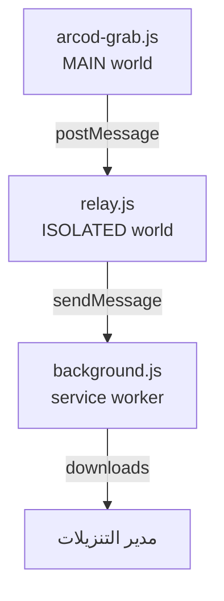

🇹🇷 [Türkçe](README.md) · [English](README.en.md) · [Deutsch](README.de.md) · [Français](README.fr.md) · [Español](README.es.md) · [Русский](README.ru.md) · **العربية**

<div dir="rtl">

> المستندات الموجودة في المجلد `docs/` متوفرة بالتركية فقط؛ الروابط المؤدية إليها تفتح النسخ التركية.

</div>

<div align="center" dir="rtl">


# ARCOD Grab

لوحة تندمج داخل صفحة **player.arcod.xyz** وتنزّل مقطعًا واحدًا أو ألبومًا كاملًا.
قبل التنزيل تقرأ الجودة **الحقيقية** للملف: عمق البت، ومعدل العيّنات، وعدد القنوات، وسلامة FLAC.

[](https://github.com/ConquerorX/arcodownloader/releases/latest)
[](#-التثبيت)
[](#-التثبيت)
[-FF7139?logo=firefoxbrowser&logoColor=white)](#-التثبيت)
[](manifest.json)
[](#-البنية)
[](docs/GIZLILIK.md)
[](LICENSE)


</div>

<div dir="rtl">

---

## لماذا؟

مشغّل ARCOD يقدّم البث من الـ origin الخاص به، ويرفض العملاء من خارج المتصفح (curl وPowerShell) برمز **502**. لذلك نقلنا التنزيل إلى *داخل الصفحة نفسها*: يخرج الطلب بجلسة الصفحة وملفات الكوكيز الخاصة بها، ثم يُسلَّم إلى مدير التنزيلات في المتصفح.

النتيجة: لا وسيط يرسل شيئًا إلى خادم، ولا ملف محفوظ في الذاكرة. فقط اللوحة وأنت ومجلد التنزيلات.

## الميزات

<table>
<tr>
<td width="50%" valign="top">

### 🎧 سقف الجودة
أربعة إعدادات مسبقة، من MP3 · 320 kbps إلى Hi-Res بدقة **24-bit · 192 kHz**. يقاطع الخادم السقف المطلوب مع الدقة الحقيقية للتسجيل، فاختيار «الأفضل» لا يؤدي أبدًا إلى رفع الجودة صناعيًا (upscale).

### 💿 ألبوم أو مقطع واحد
نزّل كل مقاطع صفحة الألبوم إلى مجلد بنقرة واحدة، أو اختر مقطعًا واحدًا. تعرض قائمة التنزيل المتسلسلة عدد المقاطع المنتظرة على شارة شريط الأدوات.

</td>
<td width="50%" valign="top">

### ✅ التحقق من الملف
قبل التنزيل تُقرأ البايتات الأولى من البث: توقيع `fLaC`، وكتلة STREAMINFO، وMD5، وVORBIS_COMMENT. تُعلَّم الملفات المعاد تغليفها أو المحذوفة وسومها بوضوح.

### ♿ الوضع السهل
خط أكبر وتباين عالٍ وأهداف لمس واسعة للمكفوفين وضعاف البصر. لا يُخفى أي محتوى، بل يصبح أسهل في القراءة.

</td>
</tr>
</table>

- **🏷️ شارة Hi-Res** — تظهر شارة شهادة بجانب اسم المقطع إذا كان التسجيل Hi-Res.
- **🎵 بطاقة «قيد التشغيل الآن»** — تراقب المشغّل أسفل الصفحة؛ تنزّل المقطع الجاري أو تضيفه إلى القائمة بنقرة واحدة.
- **🗂️ قالب اسم الملف** — `{n}` و`{title}` و`{artist}` و`{album}` و`{quality}` و`{isrc}` وغيرها.
- **💾 طريقتان للحفظ** — بث مباشر إلى القرص (أنت تختار الوجهة) أو التسليم إلى مدير التنزيلات في المتصفح.
- **🌍 7 لغات** — Türkçe وEnglish وDeutsch وFrançais وEspañol وРусский والعربية (من اليمين إلى اليسار). الإعدادات ← اللغة؛ يُطبَّق فورًا. ← [اللغات](#-اللغات)
- **🔒 صفر اعتماديات** — لا خطوة بناء، ولا خادم، ولا تحليلات. ثلاثة ملفات وملف manifest.

## 📦 التثبيت

### Chrome / Edge / Brave / Opera

```text
1.  Code ▸ Download ZIP        (أو: git clone https://github.com/ConquerorX/arcodownloader.git)
2.  فكّ ضغط ملف ZIP في مجلد
3.  chrome://extensions  →  وضع المطوّر  →  تشغيل
4.  «تحميل الإضافة غير المحزَّمة»  →  اختر المجلد
5.  https://player.arcod.xyz/  →  اضغط أيقونة ARCOD في شريط الأدوات
```

> استخدم `edge://extensions` في Edge، و`brave://extensions` في Brave، و`opera://extensions` في Opera.

### Firefox (تجريبي)

يتطلب Firefox 128+ (لدعم `world: "MAIN"` وMV3 service worker).

```text
1.  about:debugging#/runtime/this-firefox
2.  «تحميل إضافة مؤقتة»
3.  اختر ملف manifest.json
```

للتثبيت الدائم والنشر داخل المؤسسات ← **[docs/KURULUM.md](docs/KURULUM.md)** (بالتركية)

## 🚀 الاستخدام

1. افتح ألبومًا في ARCOD واضغط الأيقونة في شريط الأدوات — تُفتح اللوحة في أعلى اليمين.
2. اختر **جودة التنزيل** (الإعدادات ▸ سقف الجودة). الافتراضي: `24-bit · 192 kHz`.
3. لمقطع واحد اضغط **تنزيل** في صفّه، ولكل المقاطع اضغط **تنزيل الألبوم** في الأعلى.
4. قبل التنزيل، يُظهر **التحقق من الملف** الجودة الحقيقية للبث.
5. المقاطع التي أضفتها إلى القائمة تُنزَّل تباعًا بزر **تنزيل الكل**؛ وتعرض الشارة العدد المتبقي.

### أسقف الجودة

| الإعداد المسبق | السقف | ما يحصل عليه تسجيل CD |
|---|---|---|
| `MP3 · 320 kbps` | 16-bit / 44.1 kHz | MP3 بسرعة 320 kbps |
| `16-bit · 48 kHz` | 16-bit / 48 kHz | المصدر نفسه (16/44.1) |
| `24-bit · 96 kHz` | 24-bit / 96 kHz | المصدر نفسه (16/44.1) |
| `24-bit · 192 kHz` ⭐ | 24-bit / 192 kHz | المصدر نفسه (16/44.1) |

الجودة **سقف** وليست هدفًا. تسجيل CD يُطلب بدقة 24/192 يصل مع ذلك بدقة 16/44.1؛ ولا يُرفع صناعيًا أبدًا.

### قالب اسم الملف

الافتراضي: `{n}. {title}{version} - {artist}.flac`

| الرمز | المعنى | الرمز | المعنى |
|---|---|---|---|
| `{n}` | رقم التسلسل (`01`، `02`…) | `{quality}` | `24-bit 192 kHz` |
| `{title}` | عنوان المقطع | `{qualityShort}` | `24-192` |
| `{version}` | النسخة / ملاحظة الريمكس | `{isrc}` | رمز ISRC |
| `{artist}` | الفنان | `{year}` | السنة |
| `{album}` | اسم الألبوم | `{label}` | شركة الإنتاج |

## 🔍 ماذا يفحص التحقق؟

تقرأ اللوحة بداية البث قبل أن يبدأ التنزيل، وتعرض لك ما يصرّح به الملف نفسه، لا مجرد تخمين:

| الفحص | المعنى |
|---|---|
| توقيع `fLaC` | هل البث FLAC فعلًا؟ |
| STREAMINFO | معدل العيّنات، عمق البت، القنوات، المدة الكلية |
| MD5 `00…00` | أُعيد تغليف الملف — الصوت سليم لكنه ليس الحزمة الأصلية |
| غياب VORBIS_COMMENT | حُذفت الوسوم — فُقدت معلومات العنوان والفنان |
| خريطة الكتل | وجود كتل إضافية مثل `PADDING` و`SEEKTABLE` و`PICTURE` |

## 🧱 البنية



كل طبقة من الطبقات الثلاث تؤدي مهمة واحدة؛ ولا تُوسّع أيٌّ منها صلاحيات الأخرى. التفاصيل ← **[docs/MIMARI.md](docs/MIMARI.md)** (بالتركية)

## 🔒 الخصوصية

- يُطلب فقط إذن `https://player.arcod.xyz/*`؛ ولا يُقرأ أي موقع آخر.
- لا تُرسل أي بيانات إلى أي خادم. لا تحليلات ولا تتبّع ولا سكربتات بعيدة.
- عناوين البث اللحظية (tickets) تُستخدم لحظة التنزيل فقط؛ ولا تُكتب على القرص ولا في السجلات.
- تُحفظ الإعدادات والقائمة في `localStorage` وعلى origin الخاص بـ ARCOD فقط.

النص الكامل ← **[docs/GIZLILIK.md](docs/GIZLILIK.md)** (بالتركية)

## ❓ الأسئلة الشائعة

<details>
<summary><b>اللوحة لا تُفتح / لا يحدث شيء عند الضغط على الأيقونة</b></summary>

أعد تحميل الصفحة ثم اضغط الأيقونة مجددًا. إذا فُتح التبويب قبل تحميل الإضافة فلا يمكن إنشاء الاتصال؛ تعيد الإضافة تحميل التبويب مرة واحدة. وإن لم يُجدِ ذلك فأعد تحميل الإضافة من `chrome://extensions`.
</details>

<details>
<summary><b>التنزيل يُرجع 502</b></summary>

يرفض ARCOD بعض الطلبات بحسب حالة الجلسة / تسجيل الدخول. أعد تحميل الصفحة بشكل عادي، وشغّل المشغّل مرة واحدة، ثم أعد المحاولة.
</details>

<details>
<summary><b>الحروف التركية تتشوّه في أسماء الملفات</b></summary>

هذا متعلق بنظام ملفات نظام التشغيل؛ جرّب إبقاء القالب بسيطًا مثل `{artist} - {title}.flac`. في Windows لا يمكن استخدام الأحرف `? : * | " < >` في أسماء الملفات.
</details>

<details>
<summary><b>هل تعمل على Firefox؟</b></summary>

تعمل لكنها تجريبية: يتطلب `world: "MAIN"` الإصدار Firefox 128+، والكتابة المباشرة على القرص تحتاج File System Access API (غير متوفرة في Firefox)، ولذلك يستخدم Firefox تلقائيًا مدير التنزيلات في المتصفح.
</details>

<details>
<summary><b>لماذا ليست على Chrome Web Store؟</b></summary>

الإضافة غير موقّعة وتُوزَّع خارج المتجر؛ وكامل الشيفرة المصدرية في هذا المستودع. يمكنك تحزيمها بنفسك ورفعها إلى المتجر إن شئت.
</details>

## 🌍 اللغات

تتوفر اللوحة بـ: **Türkçe** (الافتراضية)، **English**، **Deutsch**، **Français**، **Español**، **Русский**، **العربية** (RTL). من **الإعدادات ← اللغة** اختر `تلقائي` (لغة المتصفح؛ التركية إن لم تكن مدعومة) أو حدّد لغة يدويًا؛ يُحفظ الاختيار وتُعاد رسم اللوحة دون إعادة تحميل الصفحة. عند اختيار العربية ينقلب التخطيط الداخلي من اليمين إلى اليسار؛ أما موضع اللوحة على الشاشة (الحافة اليمنى) ومقبض العرض فلا يتغيران. لا تُترجَم متغيرات قالب اسم الملف وأسماء المفاتيح والمصطلحات التقنية (FLAC وMD5 وHi-Res).

هذا الـ README متوفر أيضًا بـ: [Türkçe](README.md) · [English](README.en.md) · [Deutsch](README.de.md) · [Français](README.fr.md) · [Español](README.es.md) · [Русский](README.ru.md) · [العربية](README.ar.md). مستندات `docs/` بالتركية فقط.

**لإضافة لغة جديدة**، في `arcod-grab.js`:

1. أضف `{ id: 'it', name: 'Italiano', dir: 'ltr' }` إلى قائمة `LANGS` (واستخدم `dir: 'rtl'` للغات من اليمين إلى اليسار).
2. انسخ كتلة `I18N.tr` وترجمها باسم `I18N.it`. لا تغيّر أسماء المفاتيح؛ وأبقِ العناصر النائبة مثل `{n}` و`{name}` ووسوم `<b>` كما هي. المفتاح المفقود يعود إلى التركية.
3. لا توجد خطوة أخرى: يُغذّى محدد اللغة من `LANGS`، ويعتمد الاكتشاف التلقائي على بادئة `navigator.language`.

عند كتابة ترجمة يُنصح بالتحقق بسكربت خاص بك من أن لكل لغة المجموعة نفسها من المفاتيح والعناصر النائبة؛ ثم شغّل `node --check arcod-grab.js`.

## 🛠️ المساهمة

استخدم قسم **Issues** للإبلاغ عن الأخطاء وتقديم الاقتراحات. قبل إرسال مساهمة:

```bash
node --check arcod-grab.js && node --check background.js && node --check relay.js
```

أضف تغييراتك إلى ملاحظات الإصدار بوسم مثل `v1.0.1` ← [CHANGELOG.md](CHANGELOG.md)

> تعيش الإضافة في ملف واحد (arcod-grab.js ≈ 3,400 سطر): اللوحة وCSS ومحرك التنزيل داخل IIFE واحدة. قبل اقتراح إعادة هيكلة كبيرة افتح issue ولنخطط لها معًا.

## 📄 الرخصة والتنويه القانوني

[MIT](LICENSE) © 2026 Emre Dural

هذا المشروع **غير مرتبط بـ ARCOD**؛ وليس عميلًا رسميًا ولا واجهة API ولا قناة توزيع. هو يسهّل فقط تنزيل المحتوى الذي يحق لك الوصول إليه بحسابك الخاص، **للاستخدام الشخصي**. احترام حقوق النشر للأعمال التي تنزّلها وشروط استخدام ARCOD مسؤوليتك. لا تستخدمه لإعادة توزيع المحتوى أو مشاركته.

</div>

<div align="center">
<sub>ARCOD Grab · صُنع من أجل <a href="https://player.arcod.xyz/">player.arcod.xyz</a></sub>
</div>
