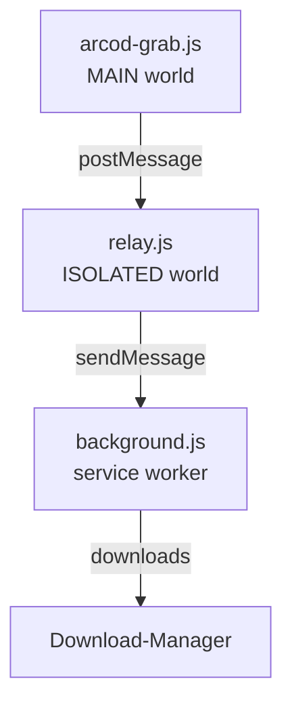

🇹🇷 [Türkçe](README.md) · [English](README.en.md) · **Deutsch** · [Français](README.fr.md) · [Español](README.es.md) · [Русский](README.ru.md)

<div align="center">


# ARCOD Grab

Ein Panel, das sich in die Seite **player.arcod.xyz** einfügt und einzelne Titel oder ganze Alben herunterlädt.
Vor dem Download liest es die **tatsächliche** Qualität der Datei aus: Bittiefe, Abtastrate, Kanalzahl und FLAC-Integrität.

[](https://github.com/ConquerorX/arcodownloader/releases/latest)
[](#-installation)
[](#-installation)
[-FF7139?logo=firefoxbrowser&logoColor=white)](#-installation)
[](manifest.json)
[](#-architektur)
[](docs/de/GIZLILIK.md)
[](LICENSE)


</div>

---

## Warum?

Der Player von ARCOD liefert den Stream von seiner eigenen Origin aus und weist Clients außerhalb des Browsers (curl, PowerShell) mit **502** ab. Deshalb haben wir den Download *in die Seite selbst* verlegt: Die Anfrage geht mit der Sitzung und den Cookies der Seite hinaus und wird an den Download-Manager des Browsers übergeben.

Das Ergebnis: keine Zwischenstation, die etwas an einen Server schickt, und keine Datei im Arbeitsspeicher. Nur das Panel, du und dein Download-Ordner.

## Funktionen

<table>
<tr>
<td width="50%" valign="top">

### 🎧 Qualitätsobergrenze
Vier Voreinstellungen, von MP3 · 320 kbps bis **24-Bit · 192 kHz** Hi-Res. Der Server schneidet die gewünschte Obergrenze mit der echten Auflösung der Aufnahme; „beste" Qualität wählen führt also nie zu einem Upscaling.

### 💿 Album oder einzelner Titel
Lade alle Titel einer Albumseite mit einem Klick in einen Ordner oder wähle einen einzelnen Titel. Eine sequenzielle Download-Warteschlange zeigt die Anzahl der ausstehenden Titel im Symbol der Symbolleiste.

</td>
<td width="50%" valign="top">

### ✅ Dateiprüfung
Vor dem Download werden die ersten Bytes des Streams gelesen: `fLaC`-Signatur, STREAMINFO-Block, MD5, VORBIS_COMMENT. Neu verpackte Dateien oder Dateien ohne Tags werden deutlich markiert.

### ♿ Einfacher Modus
Größere Schrift, hoher Kontrast und große Bedienflächen für sehbehinderte Nutzer. Nichts wird ausgeblendet, es wird nur besser lesbar.

</td>
</tr>
</table>

- **🏷️ Hi-Res-Abzeichen** — bei Hi-Res-Aufnahmen erscheint neben dem Titelnamen ein Zertifikats-Abzeichen.
- **🎵 Karte „Läuft gerade"** — beobachtet den Player am Seitenende; lädt den laufenden Titel mit einem Klick herunter oder fügt ihn der Warteschlange hinzu.
- **🗂️ Dateinamen-Vorlage** — `{n}`, `{title}`, `{artist}`, `{album}`, `{quality}`, `{isrc}` und mehr.
- **💾 Zwei Speicherwege** — direkt auf die Festplatte streamen (Ziel frei wählbar) oder an den Download-Manager des Browsers übergeben.
- **🌍 6 Sprachen** — Türkçe, English, Deutsch, Français, Español, Русский. Einstellungen → Sprache; wirkt sofort. → [Sprachen](#-sprachen)
- **🔒 Keine Abhängigkeiten** — kein Build-Schritt, kein Server, keine Analyse. Drei Dateien und ein Manifest.

## 📦 Installation

### Chrome / Edge / Brave / Opera

```text
1.  Code ▸ Download ZIP        (oder: git clone https://github.com/ConquerorX/arcodownloader.git)
2.  ZIP in einen Ordner entpacken
3.  chrome://extensions  →  Entwicklermodus  →  Ein
4.  „Entpackte Erweiterung laden"  →  Ordner auswählen
5.  https://player.arcod.xyz/  →  auf das ARCOD-Symbol in der Symbolleiste klicken
```

> Bei Edge `edge://extensions`, bei Brave `brave://extensions`, bei Opera `opera://extensions` verwenden.

### Firefox (experimentell)

Erfordert Firefox 128+ (für die Unterstützung von `world: "MAIN"` und den MV3-Service-Worker).

```text
1.  about:debugging#/runtime/this-firefox
2.  „Temporäres Add-on laden"
3.  Datei manifest.json auswählen
```

Für dauerhafte Installation und Unternehmensverteilung → **[docs/de/KURULUM.md](docs/de/KURULUM.md)**

## 🚀 Verwendung

1. Öffne auf ARCOD ein Album und klicke auf das Symbol in der Symbolleiste — das Panel öffnet sich oben rechts.
2. Wähle die **Download-Qualität** (Einstellungen ▸ Qualitätsobergrenze). Standard: `24-Bit · 192 kHz`.
3. Für einen Titel nutze **Herunterladen** in der Zeile, für alle oben **Album herunterladen**.
4. Mit **Datei prüfen** siehst du vor dem Download die tatsächliche Qualität des Streams.
5. Titel in der Warteschlange werden mit **Alle herunterladen** nacheinander geladen; das Symbol zeigt die verbleibende Anzahl.

### Qualitätsobergrenzen

| Voreinstellung | Obergrenze | Was eine CD-Aufnahme bekommt |
|---|---|---|
| `MP3 · 320 kbps` | 16-Bit / 44,1 kHz | MP3 mit 320 kbps |
| `16-Bit · 48 kHz` | 16-Bit / 48 kHz | Die Quelle selbst (16/44,1) |
| `24-Bit · 96 kHz` | 24-Bit / 96 kHz | Die Quelle selbst (16/44,1) |
| `24-Bit · 192 kHz` ⭐ | 24-Bit / 192 kHz | Die Quelle selbst (16/44,1) |

Qualität ist eine **Obergrenze**, kein Ziel. Eine CD-Aufnahme, für die 24/192 gewünscht wird, kommt trotzdem als 16/44,1 an; sie wird nie künstlich hochgerechnet.

### Dateinamen-Vorlage

Standard: `{n}. {title}{version} - {artist}.flac`

| Platzhalter | Bedeutung | Platzhalter | Bedeutung |
|---|---|---|---|
| `{n}` | Laufende Nummer (`01`, `02`…) | `{quality}` | `24-bit 192 kHz` |
| `{title}` | Titel | `{qualityShort}` | `24-192` |
| `{version}` | Version / Remix-Hinweis | `{isrc}` | ISRC-Code |
| `{artist}` | Künstler | `{year}` | Jahr |
| `{album}` | Albumname | `{label}` | Label |

## 🔍 Was prüft die Verifizierung?

Das Panel liest vor dem Download den Anfang des Streams und zeigt dir, was die Datei selbst angibt, keine Schätzung:

| Prüfung | Bedeutung |
|---|---|
| `fLaC`-Signatur | Ist der Stream wirklich FLAC? |
| STREAMINFO | Abtastrate, Bittiefe, Kanäle, Gesamtdauer |
| MD5 `00…00` | Die Datei wurde neu verpackt — der Ton ist intakt, aber nicht das Originalpaket |
| VORBIS_COMMENT fehlt | Tags wurden entfernt — Titel-/Künstlerinformationen fehlen |
| Blockübersicht | Vorhandensein zusätzlicher Blöcke wie `PADDING`, `SEEKTABLE`, `PICTURE` |

## 🧱 Architektur



Jede der drei Schichten erledigt genau eine Aufgabe; keine erweitert die Rechte einer anderen. Details → **[docs/de/MIMARI.md](docs/de/MIMARI.md)**

## 🔒 Datenschutz

- Angefordert wird nur die Berechtigung für `https://player.arcod.xyz/*`; keine andere Seite wird gelesen.
- Es werden keine Daten an irgendeinen Server gesendet. Keine Analyse, keine Telemetrie, keine Remote-Skripte.
- Kurzlebige Stream-Adressen (Tickets) werden nur im Moment des Downloads verwendet; sie werden weder auf die Festplatte noch in Protokolle geschrieben.
- Einstellungen und Warteschlange liegen in `localStorage`, ausschließlich auf der ARCOD-Origin.

Volltext → **[docs/de/GIZLILIK.md](docs/de/GIZLILIK.md)**

## ❓ FAQ

<details>
<summary><b>Das Panel öffnet sich nicht / beim Klick auf das Symbol passiert nichts</b></summary>

Lade die Seite neu und klicke das Symbol erneut an. Wurde der Tab vor dem Laden der Erweiterung geöffnet, kann keine Verbindung aufgebaut werden; die Erweiterung lädt den Tab einmal neu. Hilft das nicht, lade die Erweiterung über `chrome://extensions` neu.
</details>

<details>
<summary><b>Der Download liefert 502</b></summary>

ARCOD lehnt manche Anfragen je nach Sitzungs-/Anmeldestatus ab. Lade die Seite normal neu, spiele den Player einmal ab und versuche es dann erneut.
</details>

<details>
<summary><b>Türkische Zeichen in Dateinamen sind kaputt</b></summary>

Das liegt am Dateisystem des Betriebssystems; versuche, die Vorlage schlicht zu halten, etwa `{artist} - {title}.flac`. Unter Windows sind die Zeichen `? : * | " < >` in Dateinamen nicht erlaubt.
</details>

<details>
<summary><b>Funktioniert es in Firefox?</b></summary>

Es funktioniert, ist aber experimentell: `world: "MAIN"` erfordert Firefox 128+, und das direkte Schreiben auf die Festplatte braucht die File System Access API (in Firefox nicht vorhanden); Firefox nutzt deshalb automatisch den Download-Manager des Browsers.
</details>

<details>
<summary><b>Warum gibt es sie nicht im Chrome Web Store?</b></summary>

Die Erweiterung ist unsigniert und wird außerhalb des Stores verteilt; der gesamte Quellcode liegt in diesem Repository. Du kannst sie selbst paketieren und im Store hochladen.
</details>

## 🌍 Sprachen

Das Panel gibt es in: **Türkçe** (Standard), **English**, **Deutsch**, **Français**, **Español**, **Русский**. Unter **Einstellungen → Sprache** wählst du `automatisch` (Browsersprache; bei nicht unterstützter Sprache Türkisch) oder triffst eine manuelle Auswahl; die Wahl bleibt gespeichert, und das Panel wird ohne Seitenneuladen neu gezeichnet. Variablen der Dateinamen-Vorlage, Tastennamen und Fachbegriffe (FLAC, MD5, Hi-Res) werden nicht übersetzt.

Diese README gibt es auch in: [Türkçe](README.md) · [English](README.en.md) · [Deutsch](README.de.md) · [Français](README.fr.md) · [Español](README.es.md) · [Русский](README.ru.md).

**Eine neue Sprache hinzufügen** — in `arcod-grab.js`:

1. Trage `{ id: 'it', name: 'Italiano', dir: 'ltr' }` in die Liste `LANGS` ein.
2. Kopiere den Block `I18N.tr` und übersetze ihn als `I18N.it`. Die Schlüsselnamen nicht ändern; Platzhalter wie `{n}`, `{name}` und `<b>`-Tags unverändert lassen. Ein fehlender Schlüssel fällt auf Türkisch zurück.
3. Weitere Schritte gibt es nicht: Die Sprachauswahl wird aus `LANGS` gespeist, die automatische Erkennung prüft das Präfix von `navigator.language`.

Beim Übersetzen wird empfohlen, mit einem eigenen Skript zu prüfen, dass alle Sprachen dieselben Schlüssel und Platzhalter haben; danach `node --check arcod-grab.js`.

## 🛠️ Mitwirken

Für Fehlerberichte und Vorschläge nutze den Bereich **Issues**. Bevor du einen Beitrag einreichst:

```bash
node --check arcod-grab.js && node --check background.js && node --check relay.js
```

Trage deine Änderungen mit einem Tag wie `v1.0.1` in die Versionshinweise ein → [CHANGELOG.md](CHANGELOG.md)

> Die Erweiterung steckt in einer einzigen Datei (arcod-grab.js ≈ 3.400 Zeilen): Panel, CSS und Download-Engine liegen im selben IIFE. Bevor du ein größeres Refactoring vorschlägst, eröffne ein Issue und lass uns gemeinsam planen.

## 📄 Lizenz und rechtlicher Hinweis

[MIT](LICENSE) © 2026 Emre Dural

Dieses Projekt steht in **keiner Verbindung zu ARCOD**; es ist weder ein offizieller Client noch eine API oder ein Vertriebskanal. Es erleichtert lediglich den Download von Inhalten, auf die du mit deinem eigenen Konto zugreifen darfst, zur **privaten Nutzung**. Die Einhaltung des Urheberrechts an heruntergeladenen Werken und der Nutzungsbedingungen von ARCOD liegt in deiner Verantwortung. Verwende es nicht, um Inhalte weiterzuverbreiten oder zu teilen.

<div align="center">
<sub>ARCOD Grab · entwickelt für <a href="https://player.arcod.xyz/">player.arcod.xyz</a></sub>
</div>
