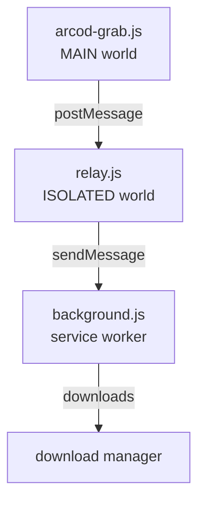

🇹🇷 [Türkçe](README.md) · **English** · [Deutsch](README.de.md) · [Français](README.fr.md) · [Español](README.es.md) · [Русский](README.ru.md) · [العربية](README.ar.md)

> Documents under `docs/` are available in Turkish only; links to them open the Turkish versions.

<div align="center">


# ARCOD Grab

A panel that sits inside the **player.arcod.xyz** page and downloads a single track or a whole album.
Before downloading, it reads the file's **real** quality: bit depth, sample rate, channel count and FLAC integrity.

[](https://github.com/ConquerorX/arcodownloader/releases/latest)
[](#-installation)
[](#-installation)
[-FF7139?logo=firefoxbrowser&logoColor=white)](#-installation)
[](manifest.json)
[](#-architecture)
[](docs/GIZLILIK.md)
[](LICENSE)


</div>

---

## Why?

ARCOD's player serves the stream from its own origin and turns away non-browser clients (curl, PowerShell) with **502**. So we moved the download into the page *itself*: the request goes out with the page's own session and cookies and is handed to the browser's download manager.

The result: no middleman sending anything to a server, no file held in memory. Just the panel, you and your download folder.

## Features

<table>
<tr>
<td width="50%" valign="top">

### 🎧 Quality ceiling
Four presets, from MP3 · 320 kbps up to **24-bit · 192 kHz** Hi-Res. The server intersects the requested ceiling with the recording's real resolution, so picking "best" never upscales.

### 💿 Album or single track
Download every track on an album page into a folder with one click, or pick a single track. A sequential download queue shows the pending count on the toolbar badge.

</td>
<td width="50%" valign="top">

### ✅ File verification
Before downloading, the first bytes of the stream are read: `fLaC` signature, STREAMINFO block, MD5, VORBIS_COMMENT. Repackaged files or files with stripped tags are clearly flagged.

### ♿ Easy Mode
Larger text, high contrast and big touch targets for visually impaired users. Nothing is hidden; it just becomes easier to read.

</td>
</tr>
</table>

- **🏷️ Hi-Res badge** — a certificate badge next to the track name when the recording is Hi-Res.
- **🎵 Now playing card** — watches the player at the bottom of the page; downloads the playing track or adds it to the queue in one click.
- **🗂️ File name template** — `{n}`, `{title}`, `{artist}`, `{album}`, `{quality}`, `{isrc}` and more.
- **💾 Two save modes** — stream straight to disk (you pick the destination) or hand off to the browser's download manager.
- **🌍 7 languages** — Türkçe, English, Deutsch, Français, Español, Русский and العربية (right-to-left). Settings → language; applied instantly. → [Languages](#-languages)
- **🔒 Zero dependencies** — no build step, no server, no analytics. Three files and a manifest.

## 📦 Installation

### Chrome / Edge / Brave / Opera

```text
1.  Code ▸ Download ZIP        (or: git clone https://github.com/ConquerorX/arcodownloader.git)
2.  Extract the ZIP into a folder
3.  chrome://extensions  →  Developer mode  →  On
4.  "Load unpacked"  →  select the folder
5.  https://player.arcod.xyz/  →  click the ARCOD icon in the toolbar
```

> Use `edge://extensions` on Edge, `brave://extensions` on Brave, `opera://extensions` on Opera.

### Firefox (experimental)

Requires Firefox 128+ (for `world: "MAIN"` support and the MV3 service worker).

```text
1.  about:debugging#/runtime/this-firefox
2.  "Load Temporary Add-on"
3.  Select the manifest.json file
```

For permanent installation and enterprise deployment → **[docs/KURULUM.md](docs/KURULUM.md)** (Turkish)

## 🚀 Usage

1. Open an album on ARCOD and click the toolbar icon — the panel opens at the top right.
2. Choose the **download quality** (Settings ▸ quality ceiling). Default: `24-bit · 192 kHz`.
3. Use **download** on a row for one track, or **download album** at the top for all of them.
4. Before downloading, use **verify file** to see the stream's real quality.
5. Tracks you add to the queue download one after another with **Download all**; the badge shows how many remain.

### Quality ceilings

| Preset | Ceiling | What a CD recording gets |
|---|---|---|
| `MP3 · 320 kbps` | 16-bit / 44.1 kHz | 320 kbps MP3 |
| `16-bit · 48 kHz` | 16-bit / 48 kHz | The source itself (16/44.1) |
| `24-bit · 96 kHz` | 24-bit / 96 kHz | The source itself (16/44.1) |
| `24-bit · 192 kHz` ⭐ | 24-bit / 192 kHz | The source itself (16/44.1) |

Quality is a **ceiling**, not a target. A CD recording requested at 24/192 still arrives as 16/44.1; it is never artificially upscaled.

### File name template

Default: `{n}. {title}{version} - {artist}.flac`

| Token | Meaning | Token | Meaning |
|---|---|---|---|
| `{n}` | Sequence number (`01`, `02`…) | `{quality}` | `24-bit 192 kHz` |
| `{title}` | Track title | `{qualityShort}` | `24-192` |
| `{version}` | Version / remix note | `{isrc}` | ISRC code |
| `{artist}` | Artist | `{year}` | Year |
| `{album}` | Album title | `{label}` | Record label |

## 🔍 What does verification check?

Before the download starts, the panel reads the head of the stream and shows you what the file itself declares, not a guess:

| Check | Meaning |
|---|---|
| `fLaC` signature | Is the stream really FLAC? |
| STREAMINFO | Sample rate, bit depth, channels, total duration |
| MD5 `00…00` | The file was repackaged — the audio is intact, but it is not the original package |
| VORBIS_COMMENT missing | Tags were stripped — title/artist information is lost |
| Block map | Presence of extra blocks such as `PADDING`, `SEEKTABLE`, `PICTURE` |

## 🧱 Architecture



Each of the three layers does one job; none extends another's privileges. Details → **[docs/MIMARI.md](docs/MIMARI.md)** (Turkish)

## 🔒 Privacy

- Only `https://player.arcod.xyz/*` permission is requested; no other site is read.
- No data is sent to any server. No analytics, telemetry or remote scripts.
- Live stream addresses (tickets) are used only at download time; they are not written to disk or logs.
- Settings and the queue are kept in `localStorage`, on the ARCOD origin only.

Full text → **[docs/GIZLILIK.md](docs/GIZLILIK.md)** (Turkish)

## ❓ FAQ

<details>
<summary><b>The panel doesn't open / nothing happens when I click the icon</b></summary>

Reload the page, then click the icon again. If the tab was opened before the extension was loaded, a connection can't be made; the extension reloads the tab once. If it still doesn't work, reload the extension from `chrome://extensions`.
</details>

<details>
<summary><b>Download returns 502</b></summary>

ARCOD rejects some requests depending on session/sign-in state. Reload the page normally, play the player once, then try again.
</details>

<details>
<summary><b>Turkish characters in file names are garbled</b></summary>

This is down to the operating system's file system; try keeping the template simple, such as `{artist} - {title}.flac`. On Windows the characters `? : * | " < >` cannot be used in file names.
</details>

<details>
<summary><b>Does it work on Firefox?</b></summary>

It works but is experimental: `world: "MAIN"` needs Firefox 128+, and writing straight to disk needs the File System Access API (not available in Firefox), so Firefox automatically uses the browser's download manager.
</details>

<details>
<summary><b>Why isn't it on the Chrome Web Store?</b></summary>

The extension is unsigned and distributed outside the store; all the source code is in this repository. You can package it yourself and upload it to the store if you like.
</details>

## 🌍 Languages

The panel comes in: **Türkçe** (default), **English**, **Deutsch**, **Français**, **Español**, **Русский**, **العربية** (RTL). Under **Settings → language** choose `auto` (browser language; Turkish if unsupported) or pick one manually; the choice is persistent and the panel redraws without a page reload. With Arabic, the inner layout flips right-to-left; the panel's position on screen (right edge) and the width handle stay the same. File name template tokens, key names and technical terms (FLAC, MD5, Hi-Res) are not translated.

This README is also available in: [Türkçe](README.md) · [English](README.en.md) · [Deutsch](README.de.md) · [Français](README.fr.md) · [Español](README.es.md) · [Русский](README.ru.md) · [العربية](README.ar.md). The documents under `docs/` are Turkish only.

**To add a new language**, in `arcod-grab.js`:

1. Add `{ id: 'it', name: 'Italiano', dir: 'ltr' }` to the `LANGS` list (use `dir: 'rtl'` for right-to-left languages).
2. Copy the `I18N.tr` block and translate it as `I18N.it`. Don't touch the key names; keep placeholders such as `{n}`, `{name}` and `<b>` tags exactly as they are. A missing key falls back to Turkish.
3. No other step: the language selector is fed from `LANGS`, and auto-detection looks at the `navigator.language` prefix.

When writing a translation, it is recommended to check with your own script that every language has the same set of keys and placeholders; then run `node --check arcod-grab.js`.

## 🛠️ Contributing

Use the **Issues** section for bug reports and suggestions. Before sending a contribution:

```bash
node --check arcod-grab.js && node --check background.js && node --check relay.js
```

Add your changes to the release notes with a tag like `v1.0.1` → [CHANGELOG.md](CHANGELOG.md)

> The extension lives in a single file (arcod-grab.js ≈ 3,400 lines): the panel, CSS and download engine are in the same IIFE. Before proposing a big refactor, open an issue and let's plan it together.

## 📄 License and legal note

[MIT](LICENSE) © 2026 Emre Dural

This project is **not affiliated with ARCOD**; it is not an official client, API or distribution channel. It only makes it easier to download, for **personal use**, content you are entitled to access with your own account. Respecting the copyright of what you download and ARCOD's terms of use is your responsibility. Do not use it to redistribute or share content.

<div align="center">
<sub>ARCOD Grab · made for <a href="https://player.arcod.xyz/">player.arcod.xyz</a></sub>
</div>
