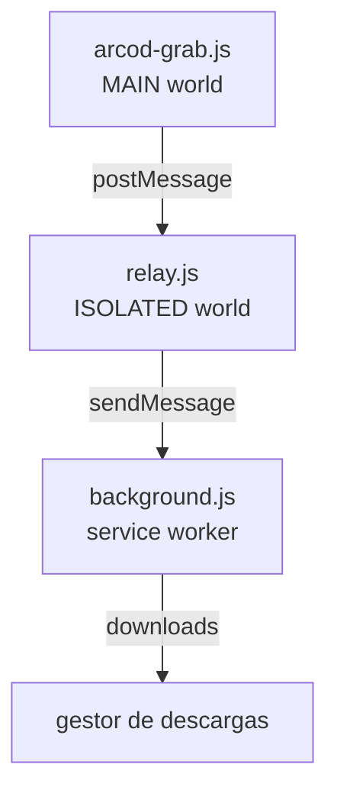

🇹🇷 [Türkçe](README.md) · [English](README.en.md) · [Deutsch](README.de.md) · [Français](README.fr.md) · **Español** · [Русский](README.ru.md)

<div align="center">


# ARCOD Grab

Un panel que se integra en la página **player.arcod.xyz** y descarga una pista suelta o un álbum completo.
Antes de descargar, lee la calidad **real** del archivo: profundidad de bits, frecuencia de muestreo, número de canales e integridad FLAC.

[](https://github.com/ConquerorX/arcodownloader/releases/latest)
[](#-instalación)
[](#-instalación)
[-FF7139?logo=firefoxbrowser&logoColor=white)](#-instalación)
[](manifest.json)
[](#-arquitectura)
[](docs/es/GIZLILIK.md)
[](LICENSE)


</div>

---

## ¿Por qué?

El reproductor de ARCOD sirve el flujo desde su propio origen y rechaza con **502** a los clientes que no son un navegador (curl, PowerShell). Por eso llevamos la descarga *al interior de la propia página*: la petición sale con la sesión y las cookies de la página y se entrega al gestor de descargas del navegador.

El resultado: ningún intermediario que envíe nada a un servidor y ningún archivo retenido en memoria. Solo el panel, tú y tu carpeta de descargas.

## Características

<table>
<tr>
<td width="50%" valign="top">

### 🎧 Techo de calidad
Cuatro preajustes, desde MP3 · 320 kbps hasta Hi-Res **24 bits · 192 kHz**. El servidor cruza el techo solicitado con la resolución real de la grabación, así que elegir «la mejor» nunca hace un reescalado artificial (upscale).

### 💿 Álbum o pista suelta
Descarga todas las pistas de la página de un álbum en una carpeta con un solo clic, o elige una sola pista. Una cola de descarga secuencial muestra el número de pendientes en la insignia de la barra de herramientas.

</td>
<td width="50%" valign="top">

### ✅ Verificación del archivo
Antes de descargar se leen los primeros bytes del flujo: firma `fLaC`, bloque STREAMINFO, MD5, VORBIS_COMMENT. Los archivos reempaquetados o sin etiquetas se marcan con claridad.

### ♿ Modo fácil
Texto más grande, alto contraste y áreas táctiles amplias para personas con discapacidad visual. No se oculta nada, solo se vuelve más legible.

</td>
</tr>
</table>

- **🏷️ Insignia Hi-Res** — si la grabación es Hi-Res, aparece una insignia de certificado junto al nombre de la pista.
- **🎵 Tarjeta «Reproduciendo ahora»** — vigila el reproductor al pie de la página; descarga la pista en curso o la añade a la cola con un clic.
- **🗂️ Plantilla de nombre de archivo** — `{n}`, `{title}`, `{artist}`, `{album}`, `{quality}`, `{isrc}` y más.
- **💾 Dos formas de guardar** — transmitir directamente al disco (tú eliges el destino) o delegar en el gestor de descargas del navegador.
- **🌍 6 idiomas** — Türkçe, English, Deutsch, Français, Español, Русский. Ajustes → idioma; se aplica al instante. → [Idiomas](#-idiomas)
- **🔒 Cero dependencias** — sin compilación, sin servidor, sin analítica. Tres archivos y un manifiesto.

## 📦 Instalación

### Chrome / Edge / Brave / Opera

```text
1.  Code ▸ Download ZIP        (o: git clone https://github.com/ConquerorX/arcodownloader.git)
2.  Descomprime el ZIP en una carpeta
3.  chrome://extensions  →  Modo de desarrollador  →  Activar
4.  «Cargar descomprimida»  →  elige la carpeta
5.  https://player.arcod.xyz/  →  pulsa el icono de ARCOD en la barra de herramientas
```

> En Edge usa `edge://extensions`, en Brave `brave://extensions`, en Opera `opera://extensions`.

### Firefox (experimental)

Requiere Firefox 128+ (para la compatibilidad con `world: "MAIN"` y el service worker MV3).

```text
1.  about:debugging#/runtime/this-firefox
2.  «Cargar complemento temporal»
3.  Elige el archivo manifest.json
```

Para la instalación permanente y la distribución empresarial → **[docs/es/KURULUM.md](docs/es/KURULUM.md)**

## 🚀 Uso

1. Abre un álbum en ARCOD y pulsa el icono de la barra de herramientas — el panel se abre arriba a la derecha.
2. Elige la **calidad de descarga** (Ajustes ▸ techo de calidad). Por defecto: `24 bits · 192 kHz`.
3. Para una pista usa **descargar** en su fila; para todas, **descargar álbum** arriba.
4. Antes de descargar, **verificar archivo** muestra la calidad real del flujo.
5. Las pistas puestas en cola se descargan una tras otra con **Descargar todo**; la insignia indica cuántas quedan.

### Techos de calidad

| Preajuste | Techo | Qué recibe una grabación de CD |
|---|---|---|
| `MP3 · 320 kbps` | 16 bits / 44,1 kHz | MP3 a 320 kbps |
| `16 bits · 48 kHz` | 16 bits / 48 kHz | La propia fuente (16/44,1) |
| `24 bits · 96 kHz` | 24 bits / 96 kHz | La propia fuente (16/44,1) |
| `24 bits · 192 kHz` ⭐ | 24 bits / 192 kHz | La propia fuente (16/44,1) |

La calidad es un **techo**, no un objetivo. Una grabación de CD que pida 24/192 llega igualmente como 16/44,1; nunca se reescala artificialmente.

### Plantilla de nombre de archivo

Por defecto: `{n}. {title}{version} - {artist}.flac`

| Variable | Significado | Variable | Significado |
|---|---|---|---|
| `{n}` | Número de orden (`01`, `02`…) | `{quality}` | `24-bit 192 kHz` |
| `{title}` | Título de la canción | `{qualityShort}` | `24-192` |
| `{version}` | Versión / nota de remix | `{isrc}` | Código ISRC |
| `{artist}` | Artista | `{year}` | Año |
| `{album}` | Título del álbum | `{label}` | Sello discográfico |

## 🔍 ¿Qué comprueba la verificación?

Antes de que empiece la descarga, el panel lee el principio del flujo y te muestra lo que declara el propio archivo, no una suposición:

| Comprobación | Significado |
|---|---|
| Firma `fLaC` | ¿Es el flujo realmente FLAC? |
| STREAMINFO | Frecuencia de muestreo, profundidad de bits, canales, duración total |
| MD5 `00…00` | El archivo fue reempaquetado — el audio está intacto, pero no es el paquete original |
| Falta VORBIS_COMMENT | Se borraron las etiquetas — se pierde el título y el artista |
| Mapa de bloques | Presencia de bloques adicionales como `PADDING`, `SEEKTABLE`, `PICTURE` |

## 🧱 Arquitectura



Cada una de las tres capas hace una sola cosa; ninguna amplía los permisos de otra. Detalles → **[docs/es/MIMARI.md](docs/es/MIMARI.md)**

## 🔒 Privacidad

- Solo se pide el permiso para `https://player.arcod.xyz/*`; no se lee ningún otro sitio.
- No se envía ningún dato a ningún servidor. Sin analítica, sin telemetría, sin scripts remotos.
- Las direcciones temporales del flujo (tickets) se usan solo en el momento de la descarga; no se escriben en disco ni en registros.
- Los ajustes y la cola se guardan en `localStorage`, solo en el origen de ARCOD.

Texto completo → **[docs/es/GIZLILIK.md](docs/es/GIZLILIK.md)**

## ❓ Preguntas frecuentes

<details>
<summary><b>El panel no se abre / no pasa nada al pulsar el icono</b></summary>

Recarga la página y vuelve a pulsar el icono. Si la pestaña se abrió antes de cargar la extensión, no se puede establecer la conexión; la extensión recarga la pestaña una vez. Si aún no funciona, recarga la extensión desde `chrome://extensions`.
</details>

<details>
<summary><b>La descarga devuelve 502</b></summary>

ARCOD rechaza algunas peticiones según el estado de la sesión o del inicio de sesión. Recarga la página con normalidad, reproduce algo una vez en el reproductor y vuelve a intentarlo.
</details>

<details>
<summary><b>Los caracteres turcos se corrompen en los nombres de archivo</b></summary>

Depende del sistema de archivos del sistema operativo; intenta mantener la plantilla sencilla, como `{artist} - {title}.flac`. En Windows, los caracteres `? : * | " < >` no se pueden usar en nombres de archivo.
</details>

<details>
<summary><b>¿Funciona en Firefox?</b></summary>

Funciona, pero es experimental: `world: "MAIN"` requiere Firefox 128+, y la escritura directa en disco necesita la File System Access API (no disponible en Firefox), por lo que Firefox usa automáticamente el gestor de descargas del navegador.
</details>

<details>
<summary><b>¿Por qué no está en la Chrome Web Store?</b></summary>

La extensión no está firmada y se distribuye fuera de la tienda; todo el código fuente está en este repositorio. Si quieres, puedes empaquetarla tú mismo y subirla a la tienda.
</details>

## 🌍 Idiomas

El panel viene en: **Türkçe** (por defecto), **English**, **Deutsch**, **Français**, **Español**, **Русский**. En **Ajustes → idioma** se elige `automático` (idioma del navegador; turco si no es compatible) o se selecciona uno manualmente; la elección es persistente y el panel se redibuja sin recargar la página. Las variables de la plantilla de nombre de archivo, los nombres de teclas y los términos técnicos (FLAC, MD5, Hi-Res) no se traducen.

Este README también está disponible en: [Türkçe](README.md) · [English](README.en.md) · [Deutsch](README.de.md) · [Français](README.fr.md) · [Español](README.es.md) · [Русский](README.ru.md).

**Para añadir un idioma nuevo**, en `arcod-grab.js`:

1. Añade `{ id: 'it', name: 'Italiano', dir: 'ltr' }` a la lista `LANGS`.
2. Copia el bloque `I18N.tr` y tradúcelo como `I18N.it`. No toques los nombres de las claves; conserva tal cual los marcadores como `{n}`, `{name}` y las etiquetas `<b>`. Una clave que falte recurre al turco.
3. No hay más pasos: el selector de idioma se alimenta de `LANGS`, y la detección automática mira el prefijo de `navigator.language`.

Al escribir una traducción se recomienda comprobar con tu propio script que todos los idiomas tengan el mismo conjunto de claves y marcadores; después, `node --check arcod-grab.js`.

## 🛠️ Contribuir

Usa la sección **Issues** para informar de errores y hacer sugerencias. Antes de enviar una contribución:

```bash
node --check arcod-grab.js && node --check background.js && node --check relay.js
```

Añade tus cambios a las notas de versión con una etiqueta como `v1.0.1` → [CHANGELOG.md](CHANGELOG.md)

> La extensión vive en un único archivo (arcod-grab.js ≈ 3.400 líneas): el panel, el CSS y el motor de descarga están en la misma IIFE. Antes de proponer un refactor grande, abre un issue y lo planificamos juntos.

## 📄 Licencia y nota legal

[MIT](LICENSE) © 2026 Emre Dural

Este proyecto **no está afiliado a ARCOD**; no es un cliente, una API ni un canal de distribución oficial. Solo facilita descargar, para **uso personal**, contenidos a los que tienes derecho a acceder con tu propia cuenta. Respetar los derechos de autor de lo que descargas y las condiciones de uso de ARCOD es responsabilidad tuya. No lo uses para redistribuir ni compartir contenidos.

<div align="center">
<sub>ARCOD Grab · hecho para <a href="https://player.arcod.xyz/">player.arcod.xyz</a></sub>
</div>
