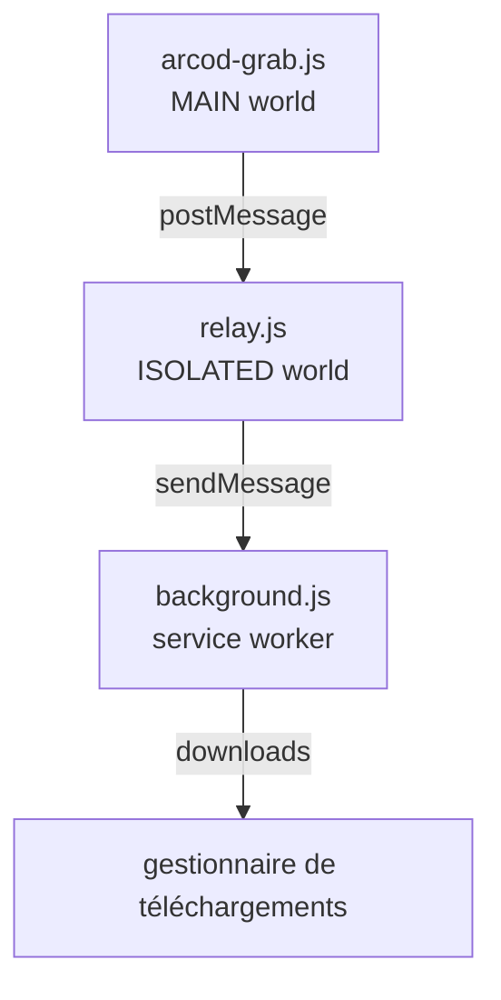

🇹🇷 [Türkçe](README.md) · [English](README.en.md) · [Deutsch](README.de.md) · **Français** · [Español](README.es.md) · [Русский](README.ru.md)

<div align="center">


# ARCOD Grab

Un panneau qui s'intègre à la page **player.arcod.xyz** et télécharge un morceau ou un album entier.
Avant le téléchargement, il lit la **vraie** qualité du fichier : profondeur de bits, fréquence d'échantillonnage, nombre de canaux et intégrité FLAC.

[](https://github.com/ConquerorX/arcodownloader/releases/latest)
[](#-installation)
[](#-installation)
[-FF7139?logo=firefoxbrowser&logoColor=white)](#-installation)
[](manifest.json)
[](#-architecture)
[](docs/fr/GIZLILIK.md)
[](LICENSE)


</div>

---

## Pourquoi ?

Le lecteur d'ARCOD diffuse le flux depuis sa propre origine et rejette les clients hors navigateur (curl, PowerShell) avec une erreur **502**. Nous avons donc déplacé le téléchargement *à l'intérieur de la page* : la requête part avec la session et les cookies de la page, puis est confiée au gestionnaire de téléchargements du navigateur.

Résultat : aucun intermédiaire n'envoie quoi que ce soit à un serveur, aucun fichier n'est gardé en mémoire. Seulement le panneau, toi et ton dossier de téléchargements.

## Fonctionnalités

<table>
<tr>
<td width="50%" valign="top">

### 🎧 Plafond de qualité
Quatre préréglages, du MP3 · 320 kbps jusqu'au Hi-Res **24 bits · 192 kHz**. Le serveur croise le plafond demandé avec la résolution réelle de l'enregistrement : choisir « la meilleure » ne fait donc jamais de suréchantillonnage.

### 💿 Album ou morceau seul
Télécharge d'un clic tous les morceaux d'une page d'album dans un dossier, ou choisis un seul morceau. Une file de téléchargement séquentielle affiche le nombre d'éléments en attente sur le badge de la barre d'outils.

</td>
<td width="50%" valign="top">

### ✅ Vérification du fichier
Avant le téléchargement, les premiers octets du flux sont lus : signature `fLaC`, bloc STREAMINFO, MD5, VORBIS_COMMENT. Les fichiers reconditionnés ou sans étiquettes sont clairement signalés.

### ♿ Mode facile
Texte plus grand, contraste élevé et grandes zones tactiles pour les personnes malvoyantes. Aucun contenu n'est masqué, il devient simplement plus lisible.

</td>
</tr>
</table>

- **🏷️ Badge Hi-Res** — un badge de certification apparaît à côté du titre quand l'enregistrement est en Hi-Res.
- **🎵 Carte « En cours de lecture »** — surveille le lecteur en bas de page ; télécharge le morceau en cours ou l'ajoute à la file d'un clic.
- **🗂️ Modèle de nom de fichier** — `{n}`, `{title}`, `{artist}`, `{album}`, `{quality}`, `{isrc}` et plus encore.
- **💾 Deux modes d'enregistrement** — écriture directe sur le disque (tu choisis la destination) ou remise au gestionnaire de téléchargements du navigateur.
- **🌍 6 langues** — Türkçe, English, Deutsch, Français, Español, Русский. Paramètres → langue ; appliqué immédiatement. → [Langues](#-langues)
- **🔒 Zéro dépendance** — pas de compilation, pas de serveur, pas d'analytique. Trois fichiers et un manifeste.

## 📦 Installation

### Chrome / Edge / Brave / Opera

```text
1.  Code ▸ Download ZIP        (ou : git clone https://github.com/ConquerorX/arcodownloader.git)
2.  Décompresser le ZIP dans un dossier
3.  chrome://extensions  →  Mode développeur  →  Activé
4.  « Charger l'extension non empaquetée »  →  choisir le dossier
5.  https://player.arcod.xyz/  →  cliquer sur l'icône ARCOD de la barre d'outils
```

> Sur Edge, utilise `edge://extensions`, sur Brave `brave://extensions`, sur Opera `opera://extensions`.

### Firefox (expérimental)

Firefox 128+ est requis (pour la prise en charge de `world: "MAIN"` et du service worker MV3).

```text
1.  about:debugging#/runtime/this-firefox
2.  « Charger un module complémentaire temporaire »
3.  Choisir le fichier manifest.json
```

Pour l'installation permanente et le déploiement en entreprise → **[docs/fr/KURULUM.md](docs/fr/KURULUM.md)**

## 🚀 Utilisation

1. Ouvre un album sur ARCOD et clique sur l'icône de la barre d'outils — le panneau s'ouvre en haut à droite.
2. Choisis la **qualité de téléchargement** (Paramètres ▸ plafond de qualité). Par défaut : `24 bits · 192 kHz`.
3. Pour un morceau, utilise **télécharger** sur sa ligne ; pour tous, **télécharger l'album** en haut.
4. Avant de télécharger, **vérifier le fichier** montre la vraie qualité du flux.
5. Les morceaux mis en file sont téléchargés l'un après l'autre avec **Tout télécharger** ; le badge indique le nombre restant.

### Plafonds de qualité

| Préréglage | Plafond | Ce que reçoit un enregistrement CD |
|---|---|---|
| `MP3 · 320 kbps` | 16 bits / 44,1 kHz | MP3 320 kbps |
| `16 bits · 48 kHz` | 16 bits / 48 kHz | La source elle-même (16/44,1) |
| `24 bits · 96 kHz` | 24 bits / 96 kHz | La source elle-même (16/44,1) |
| `24 bits · 192 kHz` ⭐ | 24 bits / 192 kHz | La source elle-même (16/44,1) |

La qualité est un **plafond**, pas un objectif. Un enregistrement CD demandé en 24/192 arrive quand même en 16/44,1 ; il n'est jamais suréchantillonné artificiellement.

### Modèle de nom de fichier

Par défaut : `{n}. {title}{version} - {artist}.flac`

| Jeton | Signification | Jeton | Signification |
|---|---|---|---|
| `{n}` | Numéro d'ordre (`01`, `02`…) | `{quality}` | `24-bit 192 kHz` |
| `{title}` | Titre du morceau | `{qualityShort}` | `24-192` |
| `{version}` | Version / note de remix | `{isrc}` | Code ISRC |
| `{artist}` | Artiste | `{year}` | Année |
| `{album}` | Titre de l'album | `{label}` | Label |

## 🔍 Que vérifie la vérification ?

Avant le début du téléchargement, le panneau lit le début du flux et te montre ce que le fichier déclare lui-même, pas une estimation :

| Contrôle | Signification |
|---|---|
| Signature `fLaC` | Le flux est-il vraiment du FLAC ? |
| STREAMINFO | Fréquence d'échantillonnage, profondeur de bits, canaux, durée totale |
| MD5 `00…00` | Le fichier a été reconditionné — l'audio est intact, mais ce n'est pas le paquet d'origine |
| VORBIS_COMMENT absent | Les étiquettes ont été supprimées — titre et artiste perdus |
| Carte des blocs | Présence de blocs supplémentaires comme `PADDING`, `SEEKTABLE`, `PICTURE` |

## 🧱 Architecture



Chacune des trois couches ne fait qu'une seule chose ; aucune n'étend les droits d'une autre. Détails → **[docs/fr/MIMARI.md](docs/fr/MIMARI.md)**

## 🔒 Confidentialité

- Seule l'autorisation `https://player.arcod.xyz/*` est demandée ; aucun autre site n'est lu.
- Aucune donnée n'est envoyée à un serveur. Ni analytique, ni télémétrie, ni script distant.
- Les adresses de flux temporaires (tickets) ne servent qu'au moment du téléchargement ; elles ne sont écrites ni sur le disque ni dans les journaux.
- Les paramètres et la file sont conservés dans `localStorage`, uniquement sur l'origine ARCOD.

Texte complet → **[docs/fr/GIZLILIK.md](docs/fr/GIZLILIK.md)**

## ❓ FAQ

<details>
<summary><b>Le panneau ne s'ouvre pas / rien ne se passe en cliquant sur l'icône</b></summary>

Recharge la page puis clique de nouveau sur l'icône. Si l'onglet a été ouvert avant le chargement de l'extension, la connexion ne peut pas s'établir ; l'extension recharge l'onglet une fois. Si ça ne marche toujours pas, recharge l'extension depuis `chrome://extensions`.
</details>

<details>
<summary><b>Le téléchargement renvoie 502</b></summary>

ARCOD rejette certaines requêtes selon l'état de la session / de la connexion. Recharge normalement la page, lance une lecture dans le lecteur, puis réessaie.
</details>

<details>
<summary><b>Les caractères turcs sont corrompus dans les noms de fichiers</b></summary>

Cela dépend du système de fichiers de l'OS ; essaie de garder un modèle simple, par exemple `{artist} - {title}.flac`. Sous Windows, les caractères `? : * | " < >` sont interdits dans les noms de fichiers.
</details>

<details>
<summary><b>Est-ce que ça fonctionne sur Firefox ?</b></summary>

Oui, mais c'est expérimental : `world: "MAIN"` exige Firefox 128+, et l'écriture directe sur le disque nécessite l'API File System Access (absente de Firefox) ; Firefox utilise donc automatiquement le gestionnaire de téléchargements du navigateur.
</details>

<details>
<summary><b>Pourquoi n'est-elle pas sur le Chrome Web Store ?</b></summary>

L'extension n'est pas signée et est distribuée hors du store ; tout le code source est dans ce dépôt. Tu peux l'empaqueter toi-même et la publier sur le store si tu le souhaites.
</details>

## 🌍 Langues

Le panneau existe en : **Türkçe** (par défaut), **English**, **Deutsch**, **Français**, **Español**, **Русский**. Dans **Paramètres → langue**, choisis `automatique` (langue du navigateur ; turc si elle n'est pas prise en charge) ou sélectionne-en une manuellement ; le choix est conservé et le panneau se redessine sans recharger la page. Les variables du modèle de nom de fichier, les noms de touches et les termes techniques (FLAC, MD5, Hi-Res) ne sont pas traduits.

Ce README existe aussi en : [Türkçe](README.md) · [English](README.en.md) · [Deutsch](README.de.md) · [Français](README.fr.md) · [Español](README.es.md) · [Русский](README.ru.md).

**Pour ajouter une langue**, dans `arcod-grab.js` :

1. Ajoute `{ id: 'it', name: 'Italiano', dir: 'ltr' }` à la liste `LANGS`.
2. Copie le bloc `I18N.tr` et traduis-le sous le nom `I18N.it`. Ne touche pas aux noms de clés ; conserve tels quels les paramètres substituables comme `{n}`, `{name}` et les balises `<b>`. Une clé manquante retombe sur le turc.
3. Rien d'autre : le sélecteur de langue est alimenté par `LANGS`, et la détection automatique regarde le préfixe de `navigator.language`.

Pendant la traduction, il est recommandé de vérifier avec ton propre script que chaque langue a le même ensemble de clés et de paramètres ; puis lance `node --check arcod-grab.js`.

## 🛠️ Contribuer

Utilise la section **Issues** pour signaler des bugs et faire des suggestions. Avant d'envoyer une contribution :

```bash
node --check arcod-grab.js && node --check background.js && node --check relay.js
```

Ajoute tes modifications aux notes de version avec une étiquette comme `v1.0.1` → [CHANGELOG.md](CHANGELOG.md)

> L'extension vit dans un seul fichier (arcod-grab.js ≈ 3 400 lignes) : le panneau, le CSS et le moteur de téléchargement sont dans la même IIFE. Avant de proposer un gros refactor, ouvre une issue et planifions-le ensemble.

## 📄 Licence et mention légale

[MIT](LICENSE) © 2026 Emre Dural

Ce projet n'est **pas affilié à ARCOD** ; ce n'est ni un client officiel, ni une API, ni un canal de distribution. Il facilite seulement le téléchargement, pour un **usage personnel**, de contenus auxquels tu as le droit d'accéder avec ton propre compte. Il t'appartient de respecter les droits d'auteur des œuvres téléchargées et les conditions d'utilisation d'ARCOD. Ne l'utilise pas pour redistribuer ou partager des contenus.

<div align="center">
<sub>ARCOD Grab · conçu pour <a href="https://player.arcod.xyz/">player.arcod.xyz</a></sub>
</div>
