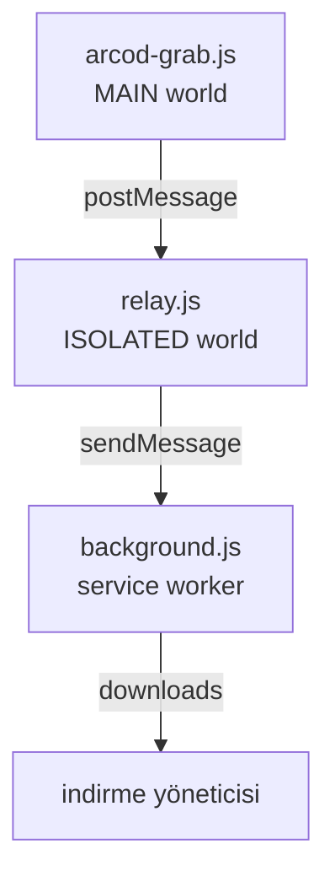

🇹🇷 **Türkçe** · [English](README.en.md) · [Deutsch](README.de.md) · [Français](README.fr.md) · [Español](README.es.md) · [Русский](README.ru.md)

<div align="center">


# ARCOD Grab

**player.arcod.xyz** sayfasının içine yerleşen, tek parça ya da bütün albümü indiren panel.
İndirmeden önce dosyanın **gerçek** kalitesini okur: bit derinliği, örnekleme hızı, kanal sayısı ve FLAC bütünlüğü.

[](https://github.com/ConquerorX/arcodownloader/releases/latest)
[](#-kurulum)
[](#-kurulum)
[-FF7139?logo=firefoxbrowser&logoColor=white)](#-kurulum)
[](manifest.json)
[](#-mimari)
[](docs/GIZLILIK.md)
[](LICENSE)


</div>

---

## Neden?

ARCOD'un oynatıcısı akışı kendi origin'inden sunar ve tarayıcı dışı istemcileri (curl, PowerShell) **502** ile geri çevirir. Bu yüzden indirme işini sayfanın *kendi içine* taşıdık: istek, sayfanın kendi oturumu ve çerezleriyle çıkar, tarayıcının indirme yöneticisine devredilir.

Sonuç: ne sunucuya bir şey gönderen bir ara katman, ne de bellekte tutulan bir dosya. Sadece panel, sen ve indirme klasörün.

## Özellikler

<table>
<tr>
<td width="50%" valign="top">

### 🎧 Kalite tavanı
MP3 · 320 kbps'den **24-bit · 192 kHz** Hi-Res'e kadar dört ön ayar. Sunucu, istenen tavanı kaydın gerçek çözünürlüğüyle kesiştirir — yani "en iyi" seçmek hiçbir zaman yükseltme (upscale) yapmaz.

### 💿 Albüm ya da tek parça
Albüm sayfasındaki bütün parçaları tek tuşla klasöre indir; istersen tek bir parçayı seç. Sıralı indirme kuyruğu, araç çubuğu rozetinde bekleyen sayıyı gösterir.

</td>
<td width="50%" valign="top">

### ✅ Dosya doğrulama
İndirmeden önce akışın ilk baytları okunur: `fLaC` imzası, STREAMINFO bloğu, MD5, VORBIS_COMMENT. Yeniden paketlenmiş veya etiketleri silinmiş dosyalar açıkça işaretlenir.

### ♿ Kolay Mod
Görme engelliler için daha büyük yazı, yüksek kontrast ve geniş dokunma hedefleri. Hiçbir içerik gizlenmez, sadece okunaklı hale gelir.

</td>
</tr>
</table>

- **🏷️ Hi-Res rozeti** — kayıt Hi-Res ise parça adının yanında sertifika rozeti.
- **🎵 Şu an çalıyor kartı** — sayfanın altındaki oynatıcıyı izler; çalan parçayı tek tuşla indirir veya kuyruğa ekler.
- **🗂️ Dosya adı şablonu** — `{n}`, `{title}`, `{artist}`, `{album}`, `{quality}`, `{isrc}` ve daha fazlası.
- **💾 İki kayıt yolu** — doğrudan diske akıt (hedefi sen seç) veya tarayıcının indirme yöneticisine bırak.
- **🌍 6 dil** — Türkçe, English, Deutsch, Français, Español, Русский. Ayarlar → dil; anında uygulanır. → [Diller](#-diller)
- **🔒 Sıfır bağımlılık** — derleme adımı yok, sunucu yok, analitik yok. Üç dosya ve bir manifest.

## 📦 Kurulum

### Chrome / Edge / Brave / Opera

```text
1.  Code ▸ Download ZIP        (ya da: git clone https://github.com/ConquerorX/arcodownloader.git)
2.  ZIP'i bir klasöre aç
3.  chrome://extensions  →  Geliştirici modu  →  Aç
4.  "Paketlenmemiş öğe yükle"  →  klasörü seç
5.  https://player.arcod.xyz/  →  araç çubuğundaki ARCOD simgesine bas
```

> Edge'de `edge://extensions`, Brave'de `brave://extensions`, Opera'da `opera://extensions` adresini kullan.

### Firefox (deneysel)

Firefox 128+ gerekir (`world: "MAIN"` desteği ve MV3 service worker için).

```text
1.  about:debugging#/runtime/this-firefox
2.  "Geçici Eklenti Yükle"
3.  manifest.json dosyasını seç
```

Kalıcı kurulum ve kurumsal dağıtım için → **[docs/KURULUM.md](docs/KURULUM.md)**

## 🚀 Kullanım

1. ARCOD'da bir albüm aç, araç çubuğundaki simgeye bas — panel sağ üstte açılır.
2. **İndirme kalitesi**ni seç (Ayarlar ▸ kalite tavanı). Varsayılan: `24-bit · 192 kHz`.
3. Tek parça için satırdaki **indir**, hepsi için üstteki **albümü indir**.
4. İndirmeden önce **dosyayı doğrula** ile akışın gerçek kalitesini gör.
5. Sıraya attığın parçalar **Tümünü İndir** ile sırayla iner; rozet kalan sayıyı gösterir.

### Kalite tavanları

| Ön ayar | Tavan | CD kaydı ne alır? |
|---|---|---|
| `MP3 · 320 kbps` | 16-bit / 44.1 kHz | 320 kbps MP3 |
| `16-bit · 48 kHz` | 16-bit / 48 kHz | Kaynağın kendisi (16/44.1) |
| `24-bit · 96 kHz` | 24-bit / 96 kHz | Kaynağın kendisi (16/44.1) |
| `24-bit · 192 kHz` ⭐ | 24-bit / 192 kHz | Kaynağın kendisi (16/44.1) |

Kalite bir **tavan**dır, hedef değil. 24/192 isteyen bir CD kaydı yine 16/44.1 gelir; hiçbir zaman yapay olarak yükseltilmez.

### Dosya adı şablonu

Varsayılan: `{n}. {title}{version} - {artist}.flac`

| Jeton | Karşılığı | Jeton | Karşılığı |
|---|---|---|---|
| `{n}` | Sıra numarası (`01`, `02`…) | `{quality}` | `24-bit 192 kHz` |
| `{title}` | Şarkı adı | `{qualityShort}` | `24-192` |
| `{version}` | Sürüm / remix notu | `{isrc}` | ISRC kodu |
| `{artist}` | Sanatçı | `{year}` | Yıl |
| `{album}` | Albüm adı | `{label}` | Plak şirketi |

## 🔍 Doğrulama neyi kontrol eder?

Panel, indirme başlamadan akışın başını okur ve sana tahmin değil, dosyanın kendi beyanını gösterir:

| Kontrol | Anlamı |
|---|---|
| `fLaC` imzası | Akış gerçekten FLAC mi? |
| STREAMINFO | Örnekleme hızı, bit derinliği, kanal, toplam süre |
| MD5 `00…00` | Dosya yeniden paketlenmiş — ses sağlam, ama orijinal paket değil |
| VORBIS_COMMENT yok | Etiketler silinmiş — şarkı adı/sanatçı bilgisi kayıp |
| Blok haritası | `PADDING`, `SEEKTABLE`, `PICTURE` gibi ek blokların varlığı |

## 🧱 Mimari



Üç katmanın her biri tek bir iş yapar; hiçbiri diğerinin yetkisini genişletmez. Ayrıntılı anlatım → **[docs/MIMARI.md](docs/MIMARI.md)**

## 🔒 Gizlilik

- Yalnızca `https://player.arcod.xyz/*` izni istenir; başka hiçbir site okunmaz.
- Hiçbir veri, hiçbir sunucuya gönderilmez. Analitik, telemetri, uzak betik yok.
- Anlık akış adresleri (ticket) yalnızca indirme anında kullanılır; diske veya günlüğe yazılmaz.
- Ayarlar ve kuyruk `localStorage`'da, yalnızca ARCOD origin'inde tutulur.

Tam metin → **[docs/GIZLILIK.md](docs/GIZLILIK.md)**

## ❓ SSS

<details>
<summary><b>Panel açılmıyor / simgeye basınca bir şey olmuyor</b></summary>

Sayfayı yeniledikten sonra simgeye tekrar bas. Sekme eklenti yüklenmeden önce açıldıysa bağlantı kurulamaz; eklenti sekmeyi bir kez yeniler. Hâlâ olmuyorsa `chrome://extensions` üzerinden eklentiyi yeniden yükle.
</details>

<details>
<summary><b>İndirme 502 veriyor</b></summary>

ARCOD bazı istekleri oturum/oturum açma durumuna göre reddeder. Sayfayı normal şekilde yenile, oynatıcıyı bir kez çalıştır, sonra tekrar dene.
</details>

<details>
<summary><b>Dosya adında Türkçe karakterler bozuluyor</b></summary>

Bu, işletim sisteminin dosya sistemiyle ilgilidir; şablonu `{artist} - {title}.flac` gibi sade tutmayı dene. Windows'ta `? : * | " < >` karakterleri dosya adında kullanılamaz.
</details>

<details>
<summary><b>Firefox'ta çalışır mı?</b></summary>

Çalışır ama deneyseldir: `world: "MAIN"` için Firefox 128+, doğrudan diske yazma için File System Access API gerekir (Firefox'ta yok), bu yüzden Firefox otomatik olarak tarayıcının indirme yöneticisini kullanır.
</details>

<details>
<summary><b>Neden Chrome Web Store'da yok?</b></summary>

Eklenti imzasız ve mağaza dışı dağıtılıyor; kaynak kodun tamamı bu depoda. İstersen kendin paketleyip mağazaya yükleyebilirsin.
</details>

## 🌍 Diller

Panel şu dillerde gelir: **Türkçe** (varsayılan), **English**, **Deutsch**, **Français**, **Español**, **Русский**. **Ayarlar → dil** bölümünde `otomatik` (tarayıcı dili; desteklenmiyorsa Türkçe) ya da elle seçim yapılır; seçim kalıcıdır ve panel sayfa yenilenmeden yeniden çizilir. Dosya adı şablon değişkenleri, tuş adları ve teknik terimler (FLAC, MD5, Hi-Res) çevrilmez.

Bu README şu dillerde de var: [Türkçe](README.md) · [English](README.en.md) · [Deutsch](README.de.md) · [Français](README.fr.md) · [Español](README.es.md) · [Русский](README.ru.md).

**Yeni dil eklemek** için `arcod-grab.js` içinde:

1. `LANGS` listesine `{ id: 'it', name: 'Italiano', dir: 'ltr' }` ekle.
2. `I18N.tr` bloğunu kopyalayıp `I18N.it` olarak çevir. Anahtar adlarına dokunma; `{n}`, `{name}` gibi yer tutucuları ve `<b>` etiketlerini aynen koru. Eksik anahtar Türkçeye düşer.
3. Başka bir adım yok: dil seçicisi `LANGS`'tan beslenir, otomatik algılama `navigator.language` ön ekine bakar.

Çeviri yazarken her dilin aynı anahtar ve yer tutucu kümesine sahip olduğunu kendi betiğinle doğrulaman önerilir; ardından `node --check arcod-grab.js`.

## 🛠️ Katkı

Hata bildirimi ve öneriler için **Issues** bölümünü kullan. Katkı göndermeden önce:

```bash
node --check arcod-grab.js && node --check background.js && node --check relay.js
```

Değişikliklerini `v1.0.1` gibi bir etiketle sürüm notlarına ekle → [CHANGELOG.md](CHANGELOG.md)

> Eklenti tek bir dosyada (arcod-grab.js ≈ 3.400 satır) yaşıyor: panel, CSS ve indirme motoru aynı IIFE içinde. Büyük bir refactor önermeden önce bir issue aç, birlikte planlayalım.

## 📄 Lisans ve yasal not

[MIT](LICENSE) © 2026 Emre Dural

Bu proje **ARCOD ile bağlantılı değildir**; resmî bir istemci, API ya da dağıtım kanalı değildir. Yalnızca kendi hesabınla erişme hakkına sahip olduğun içerikleri, **kişisel kullanım** için indirmeni kolaylaştırır. İndirdiğin eserlerin telif haklarına ve ARCOD'un kullanım koşullarına uymak senin sorumluluğundadır. İçerikleri yeniden dağıtmak veya paylaşmak için kullanma.

<div align="center">
<sub>ARCOD Grab · <a href="https://player.arcod.xyz/">player.arcod.xyz</a> için yapıldı</sub>
</div>
