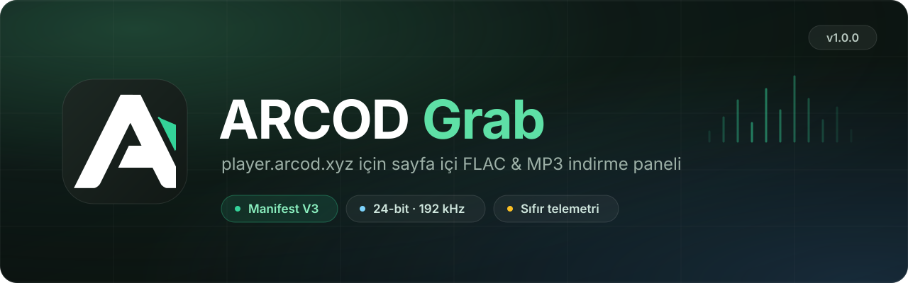
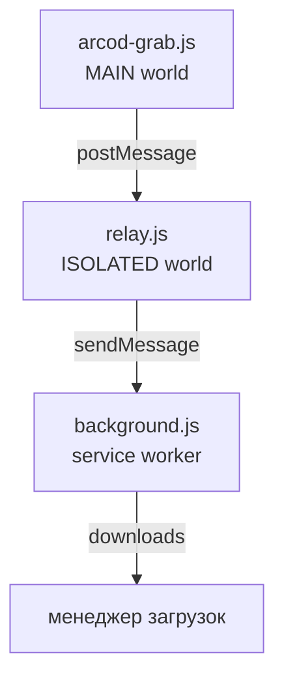

🇹🇷 [Türkçe](README.md) · [English](README.en.md) · [Deutsch](README.de.md) · [Français](README.fr.md) · [Español](README.es.md) · **Русский**

<div align="center">



# ARCOD Grab

Панель, которая встраивается в страницу **player.arcod.xyz** и скачивает отдельный трек или целый альбом.
Перед загрузкой она считывает **настоящее** качество файла: разрядность, частоту дискретизации, число каналов и целостность FLAC.

[](https://github.com/ConquerorX/arcodownloader/releases/latest)
[](#-установка)
[](#-установка)
[-FF7139?logo=firefoxbrowser&logoColor=white)](#-установка)
[](manifest.json)
[](#-архитектура)
[](docs/ru/GIZLILIK.md)
[](LICENSE)


</div>

---

## Зачем это нужно?

Плеер ARCOD отдаёт поток со своего origin и отклоняет клиентов вне браузера (curl, PowerShell) ответом **502**. Поэтому мы перенесли загрузку *внутрь самой страницы*: запрос уходит с сессией и cookie страницы и передаётся менеджеру загрузок браузера.

Итог: нет посредника, который что-то отправляет на сервер, и нет файла, удерживаемого в памяти. Только панель, вы и папка загрузок.

## Возможности

<table>
<tr>
<td width="50%" valign="top">

### 🎧 Потолок качества
Четыре пресета: от MP3 · 320 kbps до Hi-Res **24-bit · 192 kHz**. Сервер сопоставляет запрошенный потолок с реальным разрешением записи, поэтому выбор «лучшего» никогда не приводит к апскейлу (upscale).

### 💿 Альбом или отдельный трек
Скачайте все треки со страницы альбома в папку одним нажатием или выберите один трек. Последовательная очередь загрузок показывает число ожидающих на значке панели инструментов.

</td>
<td width="50%" valign="top">

### ✅ Проверка файла
Перед загрузкой считываются первые байты потока: сигнатура `fLaC`, блок STREAMINFO, MD5, VORBIS_COMMENT. Перепакованные файлы и файлы без тегов явно помечаются.

### ♿ Простой режим
Крупный шрифт, высокая контрастность и большие области нажатия для людей с нарушениями зрения. Ничего не скрывается, просто становится удобнее читать.

</td>
</tr>
</table>

- **🏷️ Значок Hi-Res** — если запись в Hi-Res, рядом с названием трека появляется значок сертификата.
- **🎵 Карточка «Сейчас играет»** — следит за плеером внизу страницы; скачивает играющий трек или добавляет его в очередь одним нажатием.
- **🗂️ Шаблон имени файла** — `{n}`, `{title}`, `{artist}`, `{album}`, `{quality}`, `{isrc}` и другие.
- **💾 Два способа сохранения** — потоком прямо на диск (место выбираете вы) или через менеджер загрузок браузера.
- **🌍 6 языков** — Türkçe, English, Deutsch, Français, Español, Русский. Настройки → язык; применяется сразу. → [Языки](#-языки)
- **🔒 Ноль зависимостей** — без сборки, без сервера, без аналитики. Три файла и манифест.

## 📦 Установка

### Chrome / Edge / Brave / Opera

```text
1.  Code ▸ Download ZIP        (или: git clone https://github.com/ConquerorX/arcodownloader.git)
2.  Распакуйте ZIP в папку
3.  chrome://extensions  →  Режим разработчика  →  Вкл.
4.  «Загрузить распакованное расширение»  →  выберите папку
5.  https://player.arcod.xyz/  →  нажмите значок ARCOD на панели инструментов
```

> В Edge используйте `edge://extensions`, в Brave — `brave://extensions`, в Opera — `opera://extensions`.

### Firefox (экспериментально)

Нужен Firefox 128+ (для поддержки `world: "MAIN"` и service worker MV3).

```text
1.  about:debugging#/runtime/this-firefox
2.  «Загрузить временное дополнение»
3.  Выберите файл manifest.json
```

Для постоянной установки и корпоративного развёртывания → **[docs/ru/KURULUM.md](docs/ru/KURULUM.md)**

## 🚀 Использование

1. Откройте альбом на ARCOD и нажмите значок на панели инструментов — панель откроется справа вверху.
2. Выберите **качество загрузки** (Настройки ▸ потолок качества). По умолчанию: `24-bit · 192 kHz`.
3. Для одного трека нажмите **скачать** в его строке, для всех — **скачать альбом** вверху.
4. Перед загрузкой **проверить файл** покажет реальное качество потока.
5. Треки из очереди скачиваются по порядку кнопкой **Скачать всё**; значок показывает, сколько осталось.

### Потолки качества

| Пресет | Потолок | Что получит запись с CD |
|---|---|---|
| `MP3 · 320 kbps` | 16-bit / 44.1 kHz | MP3 320 kbps |
| `16-bit · 48 kHz` | 16-bit / 48 kHz | Сам источник (16/44.1) |
| `24-bit · 96 kHz` | 24-bit / 96 kHz | Сам источник (16/44.1) |
| `24-bit · 192 kHz` ⭐ | 24-bit / 192 kHz | Сам источник (16/44.1) |

Качество — это **потолок**, а не цель. Запись с CD, для которой запрошено 24/192, всё равно придёт как 16/44.1; искусственного повышения не происходит.

### Шаблон имени файла

По умолчанию: `{n}. {title}{version} - {artist}.flac`

| Токен | Значение | Токен | Значение |
|---|---|---|---|
| `{n}` | Порядковый номер (`01`, `02`…) | `{quality}` | `24-bit 192 kHz` |
| `{title}` | Название трека | `{qualityShort}` | `24-192` |
| `{version}` | Версия / пометка ремикса | `{isrc}` | Код ISRC |
| `{artist}` | Исполнитель | `{year}` | Год |
| `{album}` | Название альбома | `{label}` | Лейбл |

## 🔍 Что проверяет верификация?

Перед началом загрузки панель читает начало потока и показывает не догадку, а то, что файл сообщает о себе сам:

| Проверка | Значение |
|---|---|
| Сигнатура `fLaC` | Это действительно FLAC? |
| STREAMINFO | Частота дискретизации, разрядность, каналы, общая длительность |
| MD5 `00…00` | Файл перепакован — звук цел, но это не исходный пакет |
| Нет VORBIS_COMMENT | Теги удалены — название и исполнитель утеряны |
| Карта блоков | Наличие дополнительных блоков, таких как `PADDING`, `SEEKTABLE`, `PICTURE` |

## 🧱 Архитектура



Каждый из трёх слоёв выполняет одну задачу; ни один не расширяет полномочия другого. Подробности → **[docs/ru/MIMARI.md](docs/ru/MIMARI.md)**

## 🔒 Конфиденциальность

- Запрашивается только разрешение для `https://player.arcod.xyz/*`; никакие другие сайты не читаются.
- Никакие данные не отправляются ни на один сервер. Нет аналитики, телеметрии и удалённых скриптов.
- Временные адреса потока (тикеты) используются только в момент загрузки; они не записываются ни на диск, ни в журналы.
- Настройки и очередь хранятся в `localStorage`, только на origin ARCOD.

Полный текст → **[docs/ru/GIZLILIK.md](docs/ru/GIZLILIK.md)**

## ❓ Частые вопросы

<details>
<summary><b>Панель не открывается / при нажатии на значок ничего не происходит</b></summary>

Обновите страницу и снова нажмите значок. Если вкладка была открыта до загрузки расширения, соединение установить нельзя; расширение один раз перезагрузит вкладку. Если не помогло, перезагрузите расширение на странице `chrome://extensions`.
</details>

<details>
<summary><b>Загрузка возвращает 502</b></summary>

ARCOD отклоняет часть запросов в зависимости от состояния сессии / входа. Обычным способом обновите страницу, один раз запустите воспроизведение в плеере и повторите попытку.
</details>

<details>
<summary><b>Турецкие буквы в именах файлов отображаются неправильно</b></summary>

Это зависит от файловой системы ОС; постарайтесь сделать шаблон простым, например `{artist} - {title}.flac`. В Windows символы `? : * | " < >` нельзя использовать в именах файлов.
</details>

<details>
<summary><b>Работает ли в Firefox?</b></summary>

Работает, но экспериментально: для `world: "MAIN"` нужен Firefox 128+, а для записи напрямую на диск требуется File System Access API (в Firefox его нет), поэтому Firefox автоматически использует менеджер загрузок браузера.
</details>

<details>
<summary><b>Почему нет в Chrome Web Store?</b></summary>

Расширение не подписано и распространяется вне магазина; весь исходный код находится в этом репозитории. При желании вы можете упаковать его сами и загрузить в магазин.
</details>

## 🌍 Языки

Панель доступна на языках: **Türkçe** (по умолчанию), **English**, **Deutsch**, **Français**, **Español**, **Русский**. В разделе **Настройки → язык** выберите `авто` (язык браузера; если он не поддерживается — турецкий) или задайте язык вручную; выбор сохраняется, а панель перерисовывается без перезагрузки страницы. Переменные шаблона имени файла, названия клавиш и технические термины (FLAC, MD5, Hi-Res) не переводятся.

Этот README доступен также на языках: [Türkçe](README.md) · [English](README.en.md) · [Deutsch](README.de.md) · [Français](README.fr.md) · [Español](README.es.md) · [Русский](README.ru.md).

**Чтобы добавить новый язык**, в `arcod-grab.js`:

1. Добавьте `{ id: 'it', name: 'Italiano', dir: 'ltr' }` в список `LANGS`.
2. Скопируйте блок `I18N.tr` и переведите его как `I18N.it`. Не меняйте имена ключей; плейсхолдеры вроде `{n}`, `{name}` и теги `<b>` сохраняйте без изменений. Отсутствующий ключ берётся из турецкого.
3. Больше никаких шагов: выбор языка строится из `LANGS`, а автоопределение смотрит на префикс `navigator.language`.

При переводе рекомендуется проверить собственным скриптом, что у всех языков одинаковый набор ключей и плейсхолдеров; затем выполните `node --check arcod-grab.js`.

## 🛠️ Участие в проекте

Об ошибках и предложениях сообщайте в разделе **Issues**. Перед отправкой вклада:

```bash
node --check arcod-grab.js && node --check media-hook.js && node --check background.js && node --check relay.js
```

Добавьте свои изменения в примечания к выпуску с тегом вида `v1.0.1` → [CHANGELOG.md](CHANGELOG.md)

> Расширение живёт в одном файле (arcod-grab.js ≈ 3 400 строк): панель, CSS и движок загрузки находятся в одной IIFE. Прежде чем предлагать крупный рефакторинг, откройте issue, и мы спланируем его вместе.

## 📄 Лицензия и правовое примечание

[MIT](LICENSE) © 2026 Emre Dural

Этот проект **не связан с ARCOD**; он не является официальным клиентом, API или каналом распространения. Он лишь упрощает скачивание для **личного использования** материалов, доступ к которым у вас есть с вашей собственной учётной записью. Соблюдение авторских прав на скачанные произведения и условий использования ARCOD — ваша ответственность. Не используйте его для распространения или передачи материалов другим.

<div align="center">
<sub>ARCOD Grab · создан для <a href="https://player.arcod.xyz/">player.arcod.xyz</a></sub>
</div>
